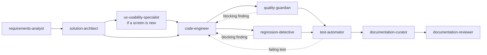

# 01. Overview and pipeline

Quorum is a template for building software with a team of AI agents instead of a team of people, without giving up the controls a human team provides. It is made of Claude Code agents, skills, `CLAUDE.md` files, two searchable knowledge bases, a vertical-slice planning method and two AI review loops (one local, one on GitHub). This page explains how the pieces fit and who runs when.

## The idea in one paragraph

An AI that writes code and also approves it is a single point of failure, and an AI that fills gaps in the requirements with plausible guesses is a liability. Quorum answers both. Every product claim must be grounded in a record (a knowledge-base chunk or a recorded decision), and the agent that produced a change is never the one that approves it. Independent reviewers with fresh context validate the work, findings go back to the producer, and after three failed rounds a human decides.

## The twelve agents

Each agent is a Markdown file in `.claude/agents/` (see [09](09-agents-and-skills.md)). Models and effort follow `docs/reference/model-selection-and-costs.md`.

| Agent | Model | Role | Writes code? |
|-------|-------|------|--------------|
| requirements-analyst | sonnet | Clarifies the request, finds gaps, grounds it in the KBs, records questions | No |
| solution-architect | opus | Designs, orders the work by dependency, cuts slices | No |
| ux-usability-specialist | opus | Defines and reviews screens and flows | No |
| code-engineer | sonnet | Implements the design | Yes |
| quality-guardian | opus | Reviews correctness, security, EF Core safety (no Write or Edit tools) | No |
| regression-detective | opus | Reviews drift, parity and contract breaks (no Write or Edit tools) | No |
| test-automator | sonnet | Writes tests and runs the gates | Tests |
| documentation-curator | sonnet | Writes docs, `CLAUDE.md`, KB chunks | Docs |
| documentation-reviewer | sonnet | Checks docs are grounded (no Write or Edit tools) | No |
| security-engineer | opus | Auth, data, API and infrastructure security | No |
| infrastructure-engineer | opus | Infrastructure as code, deployment, cost | Infra config |
| prompt-engineer | haiku | Sharpens a prompt before a complex hand-off | No |

Producers (writers) are mostly Sonnet. The reviewer model is equal to or stronger than the producer's: the judgement-heavy reviewers (quality, regression, security, architect, infrastructure, ux) run Opus at high effort, because a reviewer weaker than the author cannot reliably catch the author's mistakes ([07](07-independent-validation.md)). `documentation-reviewer` runs Sonnet because it checks grounding mechanically against sources. Subagents cannot spawn subagents or ask the user: they return open items (`questions_to_record`) to the calling session, which records or asks.

## The full lane

1. **requirements-analyst** checks the request against `business-kb` and `qa-kb`, lists gaps and records each as a question with a decider.
2. **solution-architect** produces a design and a dependency-ordered plan, stating the simplest viable option and what is deferred.
3. **ux-usability-specialist** (only when a screen is added or redesigned and no approved design exists) defines the flows, states and acceptance criteria before any code.
4. **code-engineer** implements. It never reviews its own work.
5. **quality-guardian and regression-detective run in parallel**, in one message, each with no Write or Edit tools and a fresh context. They do not overlap: quality-guardian owns correctness, security, EF Core query safety and design findings; regression-detective owns contract drift, sibling-branch parity, duplicated formulas and swallowed exceptions.
6. **test-automator** runs after the reviewers are clean, turning their "a test would catch this" hints into tests.
7. **documentation-curator** then **documentation-reviewer** update and then verify the docs.

`security-engineer` and `infrastructure-engineer` run proactively whenever a change touches authentication, data access, an API, secrets, infrastructure or deployment configuration; they sit outside the linear order. `prompt-engineer` runs on request.

## Lanes

The framework scales process to risk. The orchestrating session states the lane in one line before it starts, for example `Pipeline: full lane - requirements-analyst skip (small scope) - code-engineer -> QG||RD -> test-automator - docs: none - KB check: done - Alignment Gate: applies (src/)`.

| Lane | Use when | What changes |
|------|----------|--------------|
| Trivial | A one-line fix or typo with no behaviour change | Direct edit; normal CI still runs |
| Full | Anything not eligible for another lane | Every stage in the diagram |
| Iterate | Small, low-risk increments: a small diff (the shared patterns give an example threshold of about 150 added lines and 5 files; tune it to your team) touching no high-risk path | Requirements and architecture skipped; one review pair per batch instead of per change; cheap checks (build, format, affected tests) always run |
| Spike | The owner explicitly asks for a throwaway exploration of a screen or layout | Local only, no reviews, never merged |

Iterate is forced back to Full by triggers: migrations, entity changes, authentication or authorization, tenancy, integrity safeguards, secrets. Never waived in any lane: the Immutable Rules and the grounding rule. Outside the Trivial and Spike lanes: the pre-push gate and the local AI review (plus the GitHub AI review when `ANTHROPIC_API_KEY` is set).

## Loop-back and the three re-loop cap

A finding at a review gate sends work back to whoever wrote the artifact, not forward. Code findings go to code-engineer; documentation findings go to documentation-curator. After the fix, the reviewers run again, because a fix touches reviewed code by definition. The loop is capped at three re-loops per gate chain; if the same gate still fails, the session stops and surfaces the pattern once, because the requirements or the design may need revisiting. What blocks is fixed by one mapping in `.claude/agents/_SHARED-PATTERNS.md`: Critical and High block, Medium and Low do not; a documentation-reviewer finding (`ungrounded`, `fabricated-citation`, `stale`, `conflict`, `gate-failure`) blocks, and unverified items (confidence 0.50 to 0.79) never block; in the PR review a Blocker blocks and Warning or Info do not. Non-blocking findings are not dropped: each gets a recorded disposition (fixed, deferred with a record, or declined with a reason).

## Example: "refunds over 500 need approval" (Acme Orders)

The analyst searches `business-kb` and finds the refund chunk but nothing on approval thresholds. It records a business question, for example `BQ-010` ("Is the 500 limit per refund or per order per day?") with the product owner as decider and continues with the unblocked part, the refund endpoint. The architect cuts one slice. The engineer implements, citing the chunk id in a comment. The two reviewers run in parallel; regression-detective notices the Angular DTO lacks the new `approvalRequired` field (contract drift). The engineer fixes it, the pair re-runs clean, test-automator adds the missing test, and the curator updates the docs. When the owner answers `BQ-010`, the answer is recorded and a follow-up change applies it.

## Where to read next

The grounding rule: [04](04-never-invent.md). The knowledge bases: [02](02-business-knowledge-base.md), [03](03-questions-and-decisions-kb.md). Planning: [06](06-vertical-slices-and-planning.md). Review design: [07](07-independent-validation.md). Setting it up: [10](10-adopting-the-template.md).
