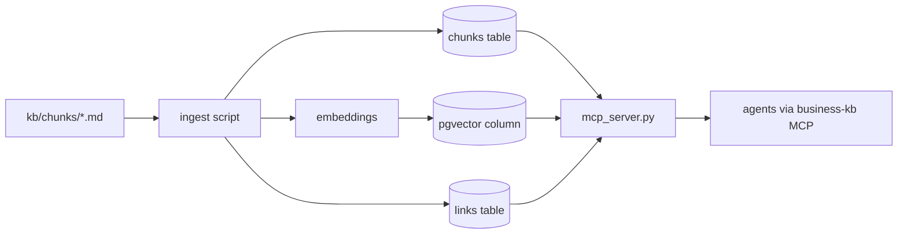

# 02. The business knowledge base

The business knowledge base (KB) is the framework's memory of what the product is supposed to do. Agents consult it instead of recalling, and every behaviour decision cites the chunk it rests on.

## Why a KB

A model's recall of your domain is generic and sometimes wrong, and a long specification does not fit in every prompt. A KB splits the domain into small, self-contained chunks that can be found by query and cited by id. Two benefits follow. Agents stay grounded ("the KB says X, chunk `BC-001`") and gaps become visible: if a search returns nothing relevant, that silence is a finding, not a licence to guess ([04](04-never-invent.md)).

## Anatomy of a chunk

A chunk is one Markdown file in `kb/chunks/`, one topic, 40 to 350 words (lint limit; aim for 80 to 300), written so it makes sense with no surrounding text (embedding search returns chunks out of context).

| Part | Purpose |
|------|---------|
| Frontmatter `chunk_id` | Stable id agents cite, for example `BC-001` |
| Frontmatter `title`, `topics` | Browsing and filtering |
| Frontmatter `links` | Ids of related chunks, the edges of the graph |
| Frontmatter `sources` | Where the statement comes from (a spec, a contract, an interview); never empty |
| Frontmatter `example` | Optional `true`: demo content to delete when you adopt the template |
| Body | The rule in plain language, with one concrete example and any stated exception |

Example, shortened from the shipped `BC-003` (an invented domain, "Acme Orders"; the field names are enforced by `scripts/kb/check_chunks.py` and described in `kb/CLAUDE.md`):

```markdown
---
chunk_id: BC-003
title: Refund eligibility and amounts
topics: [refunds]
links: [BC-001, BC-002, BC-004]
sources: ["example: invented"]
example: true
---
A refund is allowed within 30 days after delivery of a line. Each refund
references one order line and a quantity no larger than the quantity delivered
minus the quantity already refunded. A refund outside the 30-day window needs
manager approval and is recorded with the approver.
```

The shipped set is `BC-001` order lifecycle states, `BC-002` invoice issuance and numbering, `BC-003` refund eligibility and amounts (window counted from delivery), `BC-004` partial shipments and `BC-005` money amounts and rounding.

The shipped example chunks live in `kb/chunks/` and are marked as examples; replace them with your domain ([10](10-adopting-the-template.md)).

## Authoring rules

Authoring is delegated to documentation-curator and reviewed by documentation-reviewer; the rules live in `kb/CLAUDE.md`.

| Rule | Reason |
|------|--------|
| One topic per chunk | Retrieval returns whole chunks; mixed topics return noise |
| Self-contained, no "as above" | The chunk is read alone |
| State the rule, then one example | Examples anchor the rule and help the embedding |
| No filler, no restating the title | Redundancy dilutes the vector and wastes the reader's context |
| Cite `sources` for every rule | The reviewer checks the claim against the source |
| Mark uncertainty as an open question, never as a rule | Uncertain content goes to the Q&A KB ([03](03-questions-and-decisions-kb.md)) |
| Never copy copyrighted text | Summarize in your words and reference the source |

## Two backends, one content

The Markdown files are the source of truth and are reviewed in pull requests like code. A PostgreSQL database with the `pgvector` extension is a derived index that makes them searchable.



| Mode | When | How |
|------|------|-----|
| Local files only | Day one, no database yet | `scripts/kb/` loads the files and searches with BM25 plus the link graph, no database |
| PostgreSQL + pgvector | Normal operation | `scripts/kb/ingest.py` applies `kb/schema.sql`, reads the files, stores chunk text and metadata, computes an embedding per chunk and stores the links |

Each ingest run re-embeds every chunk (it is not incremental) and applies `kb/schema.sql` itself, with the vector dimension taken from `EMBED_DIM`; you do not apply the schema by hand. Because the files are the truth, the database can always be rebuilt. The embedding model and its dimension are configuration, not code; if the dimension of an existing table differs from `EMBED_DIM`, ingest stops with a message rather than corrupting the index.

## Search and graph links

`search` depends on the backend. The local backend ranks with BM25 (keyword statistics over title, topics and body) and needs no setup. The pgvector backend ranks by vector distance only. With a real embedding model that finds chunks that mean the same thing as the query ("money back for a cancelled purchase" finds the refund chunk); with the default hash embedding stub it matches shared words only and is not semantic. There is no hybrid ranking or rank fusion in the template; adding one is an extension. `search` accepts an optional topic filter.

`graph_traverse` follows the `links` edges from a chunk, so an agent that finds the refund chunk can pull the neighbouring approval and audit chunks in one call. Links are authored deliberately; a missing link is a documentation defect.

## The MCP server `business-kb`

`scripts/kb/mcp_server.py` exposes the index to every agent, registered in `.mcp.json` ([10](10-adopting-the-template.md)). It only reads.

| Tool | Use |
|------|-----|
| `search` | Find chunks by query: keyword (BM25) on the local backend, by meaning only with a real embedding model on the pgvector backend; returns ids, titles, snippets |
| `chunk` | Fetch one chunk in full by id |
| `graph_traverse` | Walk links from a chunk; `depth` is clamped to a maximum of 10 |
| `stats` | Counts per topic; used to judge whether silence means "not covered" |

In agent frontmatter the tools appear as `mcp__business-kb__search`, `mcp__business-kb__chunk`, `mcp__business-kb__graph_traverse` and `mcp__business-kb__stats`.

## How agents cite

A decision rests on ids, not on prose. In code: `// BC-001: refunds after 30 days need approval`. In a PR description, an "Alignment check" section lists each chunk id re-fetched before coding and whether the code matches. In a question record, the chunk ids that were silent or in conflict are listed. Reviewers re-fetch cited ids; a citation that does not exist is a blocking finding.

## Keeping it current

Business answers change chunks. The flow is: an answer is recorded in the Q&A KB, then documentation-curator updates the affected chunks, documentation-reviewer checks grounding, and the ingest script is re-run (when you use the pgvector backend). If the KB disagrees with the code or the docs, the discrepancy is flagged and recorded as a question, not silently resolved in either direction.
