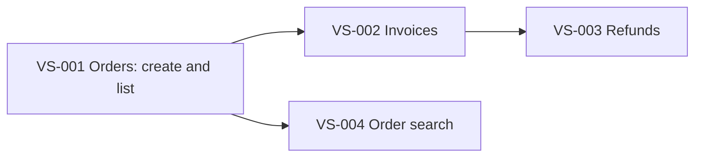

# 06. Vertical slices and planning

Quorum plans and builds software as vertical slices. This page explains what a slice is, how slices are ordered and prepared, and how progress is tracked. The working files are in `docs/slices/`: `INDEX.md` (status), `IMPLEMENTATION-GUIDE.md` (the rules), `CLAUDE.md` (upkeep rules for agents) and `templates/` (`slice.md`, `readiness-analysis.md`).

## Slice versus layer

A layered plan builds "all the entities", then "all the services", then "all the screens". Nothing works until the end, every layer is guessed in isolation, and a mistake in layer one is found in layer three. A vertical slice cuts through every layer for one user-visible capability: entity, migration, service, endpoint, Angular client, component and tests. Each slice ends with something a user can try.

| | Layered plan | Vertical slice |
|--|-------------|----------------|
| Unit of work | A technical layer | A capability a user can see |
| First working result | Late | After the first slice |
| Where mistakes surface | Late, at integration | Early, in the slice |
| Review size | Large, mixed | Small, one concern |
| Fit for agents | Poor: context spread across layers | Good: one feature folder, one context |

In code the same idea shows as feature folders: `src/Api/Features/<Feature>/{Endpoints,Service,Dtos}.cs`, an entity configuration in `src/Infrastructure`, and `frontend/src/app/features/<name>`.

## Slice ids and status

Slices have ids `VS-001`, `VS-002`, and so on, allocated sequentially and never reused. The single source of status is the table in `docs/slices/INDEX.md`. A slice moves through these states: `Proposed`, `Analysed`, `Ready`, `In progress`, `Done`, `Blocked`. Every code PR updates the INDEX in the same change (state, last rung merged, PR link), because a stale index misleads the next session. Never predict a PR number in the INDEX; open the PR first, then record it.

## Dependencies and the graph

Each slice lists the slices it hard-depends on: those that must be `Done` first because it uses their data or endpoints. A soft dependency is a convenience (shared UI) that does not block. `INDEX.md` section 2 holds the dependency graph as a Mermaid diagram, regenerated whenever the table changes.

## Readiness analysis, S1 to S5

Before implementation a slice is analysed, usually by requirements-analyst and then solution-architect, and the result is stored with `docs/slices/templates/readiness-analysis.md`.

| Step | Question | Output |
|------|----------|--------|
| S1 Ground | What do the KBs say, what was already decided? | Cited chunk and record ids, gaps listed |
| S2 Scope | What is in, out, deferred? | One acceptance criterion per behaviour |
| S2b UX | Does a design exist? (UI slices only) | Flows and states, or a define pass by ux-usability-specialist |
| S3 Design | Simplest design, data-model delta, API contract, risks | Rungs and files per rung |
| S4 Dependencies | Hard and soft dependencies, conflicts with open PRs | `Depends on` column, graph updated |
| S5 Decide | Open BQ or TQ blockers | Each recorded with a decider; slice is `Ready` only at zero blockers |

The analysis ends with a baseline stamp (the commit it was done against). Before pickup, a delta check compares that stamp with the current branch: new commits touching the slice's paths, open or merged PRs for the same slice (a sibling session may have built it already), and changed KB chunks it cites. A material delta moves the slice back to `Analysed`.

## Priority scoring

```
priority = (2*Value + 2*Urgency + Unblocks) / Effort
```

All inputs are integers from 1 to 5 (Unblocks may be 0). Value is business benefit, Urgency the cost of delay, Unblocks how many other slices wait on this one, Effort the relative size. Priority is computed, not guessed. The next slice is the highest-priority `Ready` slice whose hard dependencies are `Done`; ties go to the one that unblocks more. Any exception to "dependencies first" is a recorded decision, not a habit.

## Rungs

A slice is built as a ladder of small, independently mergeable PRs, each leaving the product working.

| Rung | Content | Gate |
|------|---------|------|
| R0 | Spec and readiness analysis merged (docs only) | Slice `Ready` |
| R1 | Entity, configuration, migration | Migration reviewed |
| R2 | Service and endpoints, unit and integration tests | Tests green |
| R3 | Angular client and component with loading, error, empty and data states | Frontend tests green |
| R4 | End-to-end journey, observability, docs | Slice `Done` |

A small slice may need fewer rungs. Branches: `main` for releases and an optional `integration` branch where rung PRs land (`docs/slices/IMPLEMENTATION-GUIDE.md`, section 3). Small PRs matter for agents as much as for people: AI review quality and the size limits of review tooling both degrade on large diffs.

## Worked example: Acme Orders (all ids and scores are examples)

The same four slices as `docs/slices/INDEX.md`. Priority = (2 x Value + 2 x Urgency + Unblocks) / Effort.

| Id | Slice | Depends on | Value | Urgency | Unblocks | Effort | Priority |
|----|-------|-----------|-------|---------|----------|--------|----------|
| VS-001 | Orders: create and list | none | 5 | 5 | 3 | 3 | 7.67 |
| VS-002 | Invoices: generate from order | VS-001 | 4 | 3 | 2 | 3 | 5.33 |
| VS-003 | Refunds: partial refund | VS-002 | 3 | 2 | 1 | 5 | 2.20 |
| VS-004 | Order search and filters | VS-001 | 3 | 2 | 0 | 2 | 5.00 |



Reading it. VS-001 is picked first: highest priority and nothing before it. Once it is `Done`, VS-002 (5.33) and VS-004 (5.00) are both startable and VS-002 goes first. VS-003 scores lowest and waits for VS-002. The critical path is the longest dependency chain: VS-001, VS-002, VS-003. Slip anywhere on it and the end date slips; VS-004 has slack and can be built in parallel with VS-002 or VS-003.

Before VS-003 starts, its readiness analysis finds that `BC-003` (refund window) is silent on digital goods. The analyst records `BQ-001` (the shipped example record), sets the product owner as decider and marks the answer as blocking rung R2 only. R1 (entity and migration) proceeds; VS-003 stays `Analysed` until `BQ-001` is answered, then becomes `Ready`.

## Who does what

| Activity | Agent | Output |
|----------|-------|--------|
| Ground and scope (S1, S2) | requirements-analyst | Findings with cited ids, records for gaps |
| Design and rungs (S3, S4) | solution-architect | Design, dependency-ordered plan |
| UX define (S2b) | ux-usability-specialist | Flows, states, acceptance criteria |
| Build a rung | code-engineer, then review pair | PR |
| Status upkeep | documentation-curator | INDEX update |

## Keeping the plan honest

The INDEX is edited in the PR that changes the state, never later. Priority inputs are re-scored when scope changes. A slice that grows beyond a few days is split, and its rungs are renumbered in the spec, not in chat. See [01](01-overview-and-pipeline.md) for lanes and [07](07-independent-validation.md) for how each rung is reviewed.
