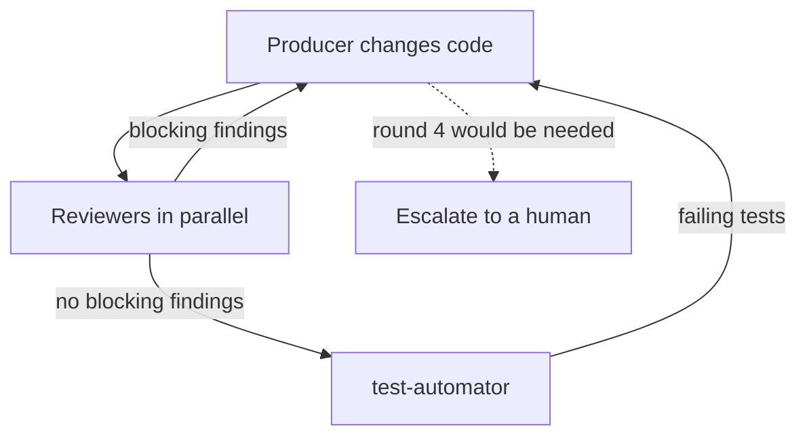

# 07. Independent validation

Quorum has no single point of failure in how work is approved. This page describes the controls that make that true, and why each exists.

## The principle

The agent that produced a change never approves it. A model reviewing its own output shares its own blind spots: the same assumption that produced the bug lets the bug pass review. So approval comes from different agents with different roles and, where it matters, a stronger model, each starting with a fresh context window, and each reporting evidence rather than a verdict.

## What makes a reviewer independent

| Property | Meaning | Why it matters |
|----------|---------|----------------|
| Different role | The reviewer's brief is to find faults, not to complete the task | Producers optimise for finishing; reviewers for finding |
| Fresh context | The reviewer is a separate subagent with its own context window and sees only the diff and the cited records, not the producer's reasoning | Reasoning that led to a bug convinces the reader of it too |
| No edit tools | Reviewers have no Write or Edit tools. Their Bash is for reading, building and testing and must not write outside build output (the agent body says so; the tool list cannot enforce it). `ux-usability-specialist` may Write only scratch mockup files outside the source tree | A reviewer that can "just fix it" stops being a reviewer, and its fix would be unreviewed |
| Equal or stronger model | The reviewer model is equal to or stronger than the producer's: judgement-heavy reviewers (quality, regression, security, architect, infrastructure, ux) run Opus at high effort; `documentation-reviewer` runs Sonnet because it checks grounding mechanically against sources | A weaker reviewer misses what a stronger author wrote |
| Non-overlapping scope | Each reviewer owns defined categories | Two reviewers on one concern means the other is unwatched |

In the agent files this shows up as `model: opus`, `effort: high`, and an allow-list of tools without `Write`, `Edit` or `Agent`. Independence comes from a fresh context on each run, not from persistent memory, so reviewers declare no `memory`.

## Two reviewers in parallel

After code-engineer finishes, `quality-guardian` and `regression-detective` are started in the same message so they run concurrently and cannot see each other's findings (no anchoring).

| Reviewer | Owns |
|----------|------|
| quality-guardian | Correctness, pattern compliance, security, EF Core query safety (N+1, unbounded queries), resource leaks, and all design findings against the Design Principles |
| regression-detective | Contract drift between API and Angular client, sibling-branch parity (two endpoints that should behave alike), config coupling, duplicated formulas drifting apart, required-invariant violations, silently swallowed exceptions |
| ux-usability-specialist (UI changes only) | Usability and screen-level design consistency, in the same message |

`test-automator` runs only after the reviewers are clean, so tests are written for the final code, and it consumes the reviewers' hints about which test would have caught each finding. Then documentation-curator updates docs and documentation-reviewer, a different agent, checks they are grounded. `security-engineer` and `infrastructure-engineer` review auth, data and infrastructure proactively, outside the line.

## Evidence format

A finding without evidence cannot be acted on or disputed. Every finding carries:

| Field | Content |
|-------|---------|
| Severity | Critical, High, Medium or Low. Critical and High block; Medium and Low do not |
| Location | `path` and symbol, with the line when needed to find it |
| Claim | One sentence: what is wrong |
| Failing scenario | The input or sequence that exposes it, for example "a refund of 0 on an invoiced order returns 500" |
| Fix direction | The smallest change that would address it |
| Test hint | The test that would have caught it, if one exists |

A bare "looks fine" is not a result. A clean review states what was checked, so silence cannot be mistaken for coverage. The tools use different scales, so `.claude/agents/_SHARED-PATTERNS.md` maps them: Critical and High block (the ux scale's Blocker and Major block too); Medium and Low do not; a documentation-reviewer finding of status `ungrounded`, `fabricated-citation`, `stale`, `conflict` or `gate-failure` blocks (confidence only decides what is reported: 0.50 to 0.79 is listed as unverified, and unverified items never block); in the PR review a Blocker blocks and Warning or Info do not.

## Where unverified items go

An unverified item is a finding the reviewer could not confirm (confidence 0.50 to 0.79) or a check it could not run (for example chunk verification while the KB is unreachable). It never blocks. Each reviewer lists it in a fixed place, and the session reads all of them:

| Reviewer | Where | Label |
|----------|-------|-------|
| quality-guardian, regression-detective | the "unverified" list in the report | `unverified (would-be <severity>): ...`, one entry per item |
| security-engineer | `areas_not_reviewed` | `unverified (would-be <severity>): ...` |
| ux-usability-specialist | the optional `unverified` list | `unverified (would-be <severity>): ...` |
| documentation-reviewer, and the `reviewing-kb-chunks` pass | `coverage_gaps` | `unverified (would-be <status>): ...` |
| infrastructure-engineer (review mode) | `coverage_gaps` (optional) | `unverified: ...`; it has no severity scale |

## Blocking, non-blocking, dispositions

Blocking findings (Critical or High severity, for example data loss, an exploitable security hole, a broken contract, a violated Immutable Rule or an unauthorised endpoint) stop the pipeline. A Medium security finding does not block; if it is not fixed before merge, the session records it as an open question and, once the owner accepts the risk, as a decision. Non-blocking findings do not stop it but are never dropped silently: each is given a disposition in the hand-off (fixed now, deferred with a recorded question or work item, or declined with a reason). Reviewers also must not raise a finding that a rule explicitly lists as a known non-issue, so the same false alarm is not re-argued each round.

## The loop and its cap

Findings of all reviewers in one round are consolidated and returned to the producer together. After the fix, the same reviewers run again, because a fix touches reviewed code and can reintroduce a caught defect. A stage is never skipped because an earlier iteration passed it. The cap is three rounds per gate (the GitHub review, when `ANTHROPIC_API_KEY` is set, caps at `MAX_ROUNDS` in its workflow, default 3). If the same gate still fails, the session stops and reports the pattern once: repeated failure usually means the requirement or design is wrong, not the code. For framework files (agents, skills, governed sections of `CLAUDE.md`) the three rounds are a single shared budget across both review gates.

Two layers of review share this model. Locally, the session runs the pair before the first push; on the pull request, when `ANTHROPIC_API_KEY` is set, the AI CI reviews again with its own round cap ([08](08-ai-ci-local-and-github.md)). A human remains the final approver and decides merges.

## Why model choice matters

Review is a task where the reviewer must understand the author's code well enough to find what the author missed. Three consequences:

1. Do not review with a cheaper model than the author. A weaker model tends to pass what it cannot follow, and false confidence is worse than no review.
2. Spend effort where it pays: the judgement-heavy reviewers, architect and security at high effort; mechanical work (formatting a doc, grounding lookups, bulk edits) on cheaper tiers.
3. Independence is not only a different prompt. A second reviewer of the same model with a different brief catches different things, which is why the pair is split by concern rather than duplicated.

Defaults per agent, the cost of one review round and levers to reduce spend are in `docs/reference/model-selection-and-costs.md`. Revisit the table when a new model generation ships.

## Example

code-engineer adds `POST /refunds`. quality-guardian reports (blocking) that the handler loads all refunds for the order into memory to sum them (unbounded query; failing scenario: an order with 50,000 refund lines), pointing at the service method. regression-detective reports (non-blocking) that the invoice endpoint rounds amounts to 2 decimals while the new one does not (duplicated formula drift; test hint: compare totals for 0.005). Both go back to code-engineer in one batch, both are fixed, the pair re-runs clean in round two, and test-automator adds the two tests. Neither reviewer touched the code, and neither saw the other's report before writing its own.

Related: [01](01-overview-and-pipeline.md), [04](04-never-invent.md), [09](09-agents-and-skills.md).
