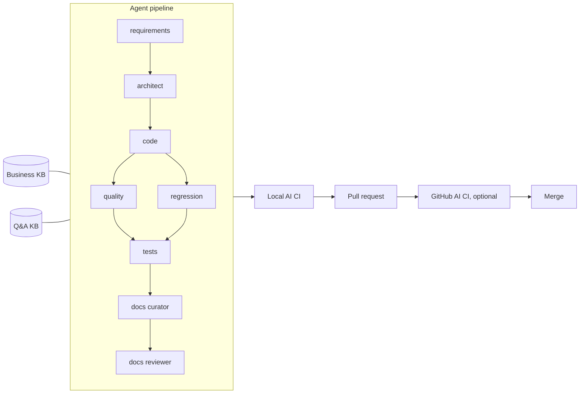
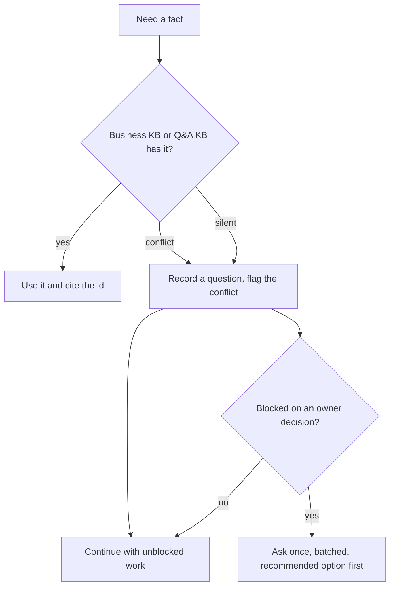
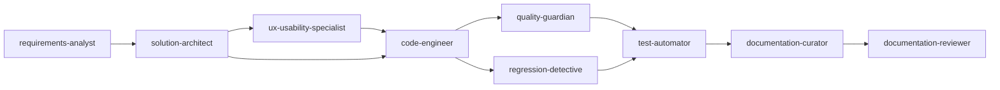
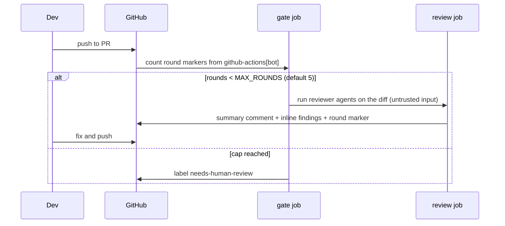
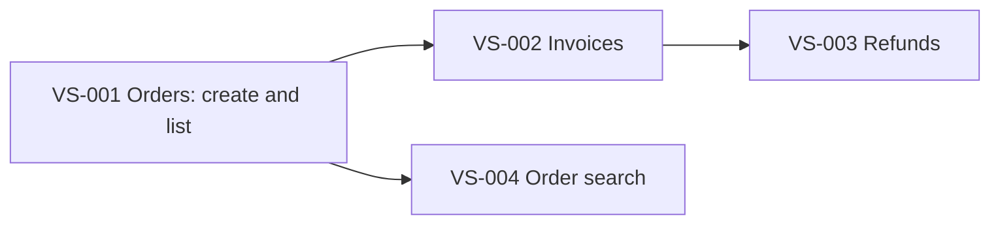

<!--
How to view: on GitHub this renders as a long document; each "---" is a slide break, and the Mermaid diagrams render there.
As slides: open in VS Code with the Marp extension, or run `npx @marp-team/marp-cli docs/presentation/quorum-framework.md --html`.
Caveat: plain Marp does not render Mermaid blocks; they show as code. Use the GitHub view for diagrams, or add a Mermaid plugin to your Marp setup.
-->

# Quorum

An agentic software engineering framework built from Claude Code agents, skills and knowledge bases.

Agents that never invent, and never mark their own homework.

---

## The problem

A single AI coding assistant, left alone, has three failure modes:

| Failure | What it looks like |
|---|---|
| It invents | Plausible business rules, field names and behaviours nobody specified |
| It forgets | Yesterday's decision is re-litigated today, or silently reversed |
| It self-approves | The author reviews its own diff and finds it fine |

Quorum is a set of conventions, agents and tooling that removes all three.

---

## Five ideas

1. **Ground it**: two knowledge bases are the memory (business facts, questions and decisions).
2. **Never invent**: consult the knowledge, or record a question. Never guess.
3. **Specialize**: twelve agents, each with one role, tools and a model sized to the job.
4. **Validate independently**: the producer never approves its own work.
5. **Slice vertically**: plan and ship features end to end, in small ordered increments.

Everything else in this deck follows from these five.

---

## The big picture



---

## Knowledge base 1: the business KB

What the product must do, in small self-contained chunks.

| Aspect | Choice |
|---|---|
| Unit | One chunk = one topic, 40-350 words (aim 80-300), own id (`BC-001`) |
| Frontmatter | `chunk_id`, `title`, `topics`, `links`, `sources`, optional `example` |
| Storage (local) | Markdown files in `kb/chunks/`, searched with BM25 plus the link graph, no database |
| Storage (scaled) | PostgreSQL + pgvector: vector distance only; not semantic with the default hash embedding stub |
| Retrieval | `search`, `chunk` (by id), `graph_traverse` (follow links), `stats` |
| Access | MCP server `business-kb`, so every agent queries it the same way |
| Rule | Agents cite chunk ids for every behavioural claim |

Same content either way. Start local, move to pgvector with a real embedding model when the corpus grows. Ingest applies the schema itself and re-embeds everything on each run.

---

## Knowledge base 2: questions and decisions

What has been asked, what was answered, what was decided, and by whom.

| Record | Meaning |
|---|---|
| `BQ-nnn` | Business question, decider is a business role |
| `TQ-nnn` | Technical question, decider is a technical role |
| `OD-nnn` | Owner decision, with options, choice and rationale |

- Statuses: `open`, `answered`, `decided`, `closed`. A replaced decision is `closed` with a "Superseded by" line in its History.
- Fields: `priority` P1-P3, `decider`, `asked`, optional `answered`, `related`, `chunks`, optional `example`.
- Same dual backend (Markdown files, or PostgreSQL + pgvector) and an MCP server `qa-kb` with `search` (filters `kind`, `status`), `get`, `open`, `related`.
- **Recall before ask**: search first. **Record every answer** the moment it is given.

---

## Never invent



"Flag it" means record and carry on. "Ask" is reserved for a real block.

---

## The agents (1/2): plan and build

| Agent | Model | Job |
|---|---|---|
| requirements-analyst | sonnet | Find gaps, ground the request in the KBs, record questions |
| solution-architect | opus | Simplest viable design, dependency-ordered plan, slices |
| ux-usability-specialist | opus | Define or review flows, states, microcopy |
| code-engineer | sonnet | Implement the approved design |
| test-automator | sonnet | Unit, integration, e2e, mutation, load tests; run them |

---

## The agents (2/2): review, document, protect

| Agent | Model | Job |
|---|---|---|
| quality-guardian | opus | Correctness, security, EF Core safety, leaks (no Write or Edit) |
| regression-detective | opus | Contract drift, sibling parity, duplicated logic (no Write or Edit) |
| documentation-curator | sonnet | Write docs, CLAUDE.md files, KB chunks |
| documentation-reviewer | sonnet | Check every claim is grounded (no Write or Edit) |
| security-engineer | opus | Auth, data, API, infrastructure, tenancy |
| infrastructure-engineer | opus | Infrastructure as code, deployment, cost |
| prompt-engineer | haiku | Sharpen prompts before a hard task |

Spend on the checker, save on the maker. See the cost reference.

---

## The pipeline



- `ux-usability-specialist` only when a screen is added or redesigned.
- `quality-guardian` and `regression-detective` run **in parallel**, with fresh context.
- `security-engineer` and `infrastructure-engineer` run proactively on auth, data, API, secret or infra changes.

---

## Pipelines (lanes)

| Lane | When | Stages |
|---|---|---|
| Trivial | One-line fix, no behaviour change | direct edit, normal CI |
| Iterate | Small low-risk increment (example threshold: about 150 added lines and 5 files; tune it) with no migration, auth or secrets change | code, review gate per batch, tests if uncovered |
| Full | New behaviour, schema change, anything risky | analyst, architect, [UX], code, QG and RD, tests, docs |
| Spike | Throwaway exploration; the owner must ask for it | local only, no review, never merged |

Every task states its lane and any skipped stage in one line before work starts.

---

## Independent validation: no single point of failure

A critical system must never rely on one checker, and the author is never the checker.

| Principle | In practice |
|---|---|
| Producer never approves | The agent that wrote the diff cannot be its reviewer |
| Independent context | Reviewers start fresh, with no Write or Edit tools, so they cannot be anchored by the author's reasoning or patch what they find |
| Equal or stronger model | Reviewer model is equal or stronger than the producer's: judgement-heavy reviewers run Opus, documentation-reviewer runs Sonnet (mechanical grounding check) |
| Different lenses | Quality asks "is it right?", regression asks "what did it break?" |
| Evidence, not verdicts | Each finding has a file and anchor, a failing scenario and a severity (Critical and High block; Medium and Low do not) |
| Bounded loops | Findings return to the producer, 5 re-loops at most per gate chain, then a human |

---

## Two AI CIs

| | Local AI CI | GitHub AI CI |
|---|---|---|
| Runs | On your machine, before the first push | On every PR, in GitHub Actions |
| Entry | `scripts/ai_review_local.py` | `.github/workflows/ai-pr-review.yml` |
| Purpose | Required gate with the in-session pair; no API key | Optional second gate the author cannot skip; needs `ANTHROPIC_API_KEY` |
| Model | Default `sonnet`; `--model opus` for risky changes | Default `opus` (variable `AI_REVIEW_MODEL` overrides) |
| Reviewers | quality-guardian and regression-detective prompts | the same two agents, read from the base branch |
| Output | `.ai-review/` findings (JSON and Markdown) | one summary plus up to 20 inline comments |
| Cap | `--max-rounds`, default 5 | `MAX_ROUNDS` in the workflow, default 5, then label `needs-human-review` |

The local run is the required review. The GitHub run is an optional second gate: without the key it is skipped and its green check is not a review. Thread resolution, path-based model tiers and diff chunking are optional extensions, not implemented.

---

## The GitHub AI CI flow



The PR content is treated as data, never as instructions. Reviewer instructions come from the base branch.

---

## Claude Code basics: agent vs skill vs the rest

| Concept | What it is | Loaded |
|---|---|---|
| **Agent** (subagent) | A role with its own context window, tool allow-list and model, in `.claude/agents/*.md` | When delegated to |
| **Skill** | A packaged how-to in `.claude/skills/<name>/SKILL.md`; the short `description` is always visible, the body loads only when relevant | On demand |
| **CLAUDE.md** | Standing project instructions; the nearest file to the edited code wins | Automatically |
| **MCP server** | A tool endpoint (here: the two KBs) | At session start |
| **Hook** | A script the harness runs on an event (e.g. pre-commit lint) | By the harness, not the model |
| **Settings** | Permissions and enabled servers in `.claude/settings.json` | At session start |

Agents are *who*, skills are *how*, CLAUDE.md is *the house rules*, MCP is *the memory*.

---

## The CLAUDE.md files

```
CLAUDE.md                     root: objective, rules, stack, pipeline, delegation
src/Api/CLAUDE.md             endpoints, options, auth, error shape
src/Infrastructure/CLAUDE.md  EF Core, naming, migration workflow
frontend/CLAUDE.md            Angular conventions, tests
tests/CLAUDE.md               test conventions
docs/CLAUDE.md                prose rules
docs/slices/CLAUDE.md         slice planning upkeep
kb/CLAUDE.md  questions/CLAUDE.md   chunk and record authoring
```

- Root file: rules that apply everywhere. Sub-files: only non-obvious conventions of their layer.
- Keep each bounded. Detail moves into skills so the always-loaded context stays small.

---

## A sub-CLAUDE.md, excerpt

From `src/Api/CLAUDE.md`: loaded only when you work under `src/Api/`, it adds to the root and never contradicts it.

| Topic | Rule |
|---|---|
| Endpoints | `Map<Feature>Endpoints` returns a group that calls `RequireAuthorization()` explicitly (Immutable Rule 7); an anonymous endpoint needs `AllowAnonymous()` and a comment saying why |
| DTOs | `record` types, validated at the boundary, never EF entities |
| Pagination | every list takes `page` and `pageSize` and clamps `pageSize` to a configured maximum |
| Errors | `Results.Problem` (RFC 9457); never leak exception text |

---

## Skills: how the agents know how

39 skills in `.claude/skills/`, in seven groups (full list on the next slides). Only name and description are always in context; the body loads when the task matches. `python3 scripts/framework_lint.py` checks the index against the folders.

---

## All 39 skills (1/2)

| Group | Skills and purpose |
|---|---|
| Backend (8) | `backend` endpoints with auth and errors; `creating-application-services` DI services; `creating-dtos-and-validation` record DTOs; `creating-configuration-options` Options pattern; `creating-cli-tools` System.CommandLine tools; `implementing-caching-strategies` cache only for a measured need; `implementing-observability` logs, metrics, traces; `managing-application-lifecycle` startup, health, draining |
| Data (4) | `database` EF Core conventions; `writing-postgresql-migrations` safe migrations; `tuning-postgresql-queries` plan-based tuning; `scaling-performance-test-data` scaled lab data |
| Delivery and infrastructure (2) | `deploying-the-application` build, CI stages, image deploy; `implementing-infrastructure-as-code` infrastructure as code, tool of your choice |
| Frontend (4) | `frontend` standalone Angular; `managing-state-with-signals` signal stores; `creating-angular-api-clients` typed clients; `evaluating-usability` walkthrough and heuristics |

---

## All 39 skills (2/2)

| Group | Skills and purpose |
|---|---|
| Testing and quality (8) | `creating-xunit-tests` unit; `writing-integration-tests` Testcontainers; `writing-angular-tests` Vitest; `writing-playwright-e2e-tests` journeys; `running-mutation-tests` Stryker; `load-and-performance-testing` k6; `detecting-regressions` B1-B6 taxonomy; `verifying-cross-file-coupling` drift checks |
| Documentation and knowledge (7) | `reviewing-documentation` grounding review; `updating-internal-docs` terse style; `updating-external-docs` natural style; `writing-kb-chunks`; `reviewing-kb-chunks`; `recording-decisions` BQ, TQ, OD; `writing-world-class-prompts` |
| Planning, process and framework (6) | `implementing-vertical-slice-features` file order; `planning-vertical-slices` ids, readiness, priority; `running-local-ai-review` required pre-push review; `pr-review` review prompt (local and optional GitHub); `maintaining-agent-framework` lint and budgets; `routing-to-skills` task to skill |

---

## Vertical slices

A slice is one user-visible outcome built through every layer.

```
Horizontal (avoid)                 Vertical (use)
  all entities                       VS-001 Orders: create and list
  all services          becomes        entity -> migration -> service
  all endpoints                        -> endpoint -> Angular client
  all screens                          -> component -> tests
```

- Each slice has an id (`VS-001`), an outcome, the layers it touches, its dependencies, and tests.
- A slice is cut into **rungs**: PR-sized increments that can merge on their own.
- The feature folder, not the layer, is the unit of ownership.

---

## Building the plan



Example set, as in `docs/slices/INDEX.md`: priorities 7.67, 5.33, 2.20 and 5.00.

Steps:
1. **List** outcomes from the business KB.
2. **Cut** each into a vertical slice with an id.
3. **Order** by dependency (a graph, no cycles).
4. **Analyse readiness** for each slice.
5. **Prioritize**, find the critical path, pick the next rung.
6. Keep `docs/slices/INDEX.md` current in every PR.

---

## Readiness analysis

A slice is `Ready` only when steps S1 to S5 are done with zero open blockers.

| Step | Ready when |
|---|---|
| S1 Ground | Behaviour traces to business KB chunk ids and recorded decisions; gaps listed |
| S2 Scope | In, out and deferred stated; one acceptance criterion per behaviour |
| S2b UX | Flows and states defined, if a screen is involved |
| S3 Design | Simplest design, data-model delta, API contract, rungs and files per rung |
| S4 Dependencies | Hard and soft dependencies known; no conflict with open PRs |
| S5 Decide | Every open BQ/TQ blocker recorded with a decider and resolved |

Not ready? Record the missing items as questions and pick another slice. Do not guess.

---

## Priorities

```
priority = (2*Value + 2*Urgency + Unblocks) / Effort
```

| Factor | Question |
|---|---|
| Value | How much does the outcome matter to users? (1-5) |
| Urgency | What does a delay cost? (1-5) |
| Unblocks | How many slices wait behind it? (0-5) |
| Effort | Relative size (1-5) |

Highest priority among `Ready` slices whose hard dependencies are `Done` goes first; ties go to the one that unblocks more. The inputs and score live in `docs/slices/INDEX.md` so the order is auditable.

---

## Model selection and cost

| Tier | Use for | Price per MTok (in / out) |
|---|---|---|
| Opus 5.5 | Judgement-heavy review, architecture, security | $4 / $20 |
| Sonnet 5.5 | Implementation, tests, docs, requirements, documentation-reviewer | $2 / $10 |
| Haiku 5.5 | Prompt sharpening, triage, bulk simple work | $0.10 / $0.50 |
| Fable 5.2 | Hardest long-horizon work, used sparingly | $8 / $40 |

Levers, in order: cache repeated context, send diffs not files, right-size model and effort, batch what can wait (50% off), cap review rounds, run the local AI CI first. Prices were re-verified on 2026-11-19 against the Anthropic pricing page (model ids and effort defaults come from the API reference cached 2026-11-03); check the pricing page before budgeting (see `docs/reference/model-selection-and-costs.md`).

---

## Effort levels and the advisor pattern

| Effort | Typical use |
|---|---|
| `low` | simple subagent tasks, routing, classification |
| `medium` | documentation, straightforward edits |
| `high` | coding, review, requirements analysis (most agents here) |
| `xhigh`, `max` | hard agentic work; measuring a ceiling |

- Effort is the quality-versus-cost dial inside one model. Tune per agent, after measuring real tasks. The per-model defaults come from the Anthropic API reference (cached 2026-11-03).
- **Advisor pattern**: a cheaper executor does the work and consults a stronger advisor before committing to an approach, when stuck and before declaring done. Same idea as independent review, applied inside one task.
- The advisor does not replace the reviewer agents: it is early correction, they are the independent final check.

---

## What a change looks like end to end

1. Pick the next ready slice rung from `docs/slices/INDEX.md`.
2. State the pipeline lane in one line.
3. **Alignment gate**: check the spec against both KBs, cite chunk ids, record any gap as a question.
4. Design, build, then review in parallel with independent agents.
5. Tests and docs, then the **local AI CI** (required, rounds capped at 5, then a human).
6. Push, open a PR; if `ANTHROPIC_API_KEY` is set, **GitHub AI CI** also loops until a round is clean (`MAX_ROUNDS`, default 5). A human merges.
7. Merge, update the slice status, record any new decision.

---

## Adopting Quorum

1. Use the repo as a template, and replace every `{{PLACEHOLDER}}`.
2. Write your first business KB chunks and seed the Q&A KB.
3. Optional: export `.env` (`set -a; source .env; set +a`), start Postgres with `docker compose up -d` and ingest (local mode needs nothing).
4. Check the two MCP servers register (`.mcp.json`).
5. Build your first slice list with the planning skill.
6. Tune models and effort per agent after measuring a few real tasks.
7. Optional: add the repository secret `ANTHROPIC_API_KEY` for the GitHub AI CI.

Full guide: `docs/concepts/10-adopting-the-template.md`.

---

## Where to read more

| Topic | File |
|---|---|
| Overview and pipelines | `docs/concepts/01-overview-and-pipeline.md` |
| Business KB | `docs/concepts/02-business-knowledge-base.md` |
| Q&A KB | `docs/concepts/03-questions-and-decisions-kb.md` |
| Never invent | `docs/concepts/04-never-invent.md` |
| CLAUDE.md files | `docs/concepts/05-claude-md-files.md` |
| Slices and planning | `docs/concepts/06-vertical-slices-and-planning.md` |
| Independent validation | `docs/concepts/07-independent-validation.md` |
| Local and GitHub AI CI | `docs/concepts/08-ai-ci-local-and-github.md` |
| Agents and skills | `docs/concepts/09-agents-and-skills.md` |
| Models and costs | `docs/reference/model-selection-and-costs.md` |

---

# Questions?

Quorum: agents that ground, specialize, and check each other.
