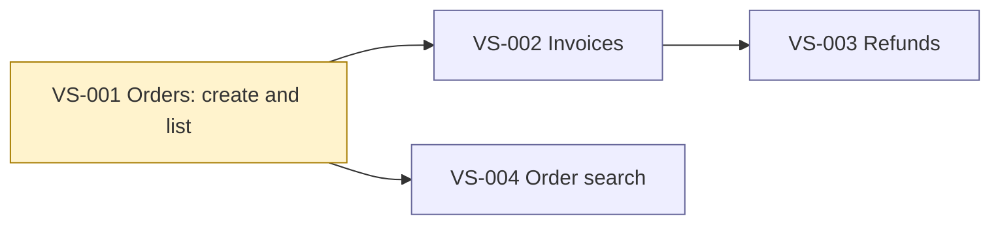

# Slice Index

The single status table for vertical slices. Example rows below use the invented "Acme Orders" domain; replace them with your own. Process: [`IMPLEMENTATION-GUIDE.md`](IMPLEMENTATION-GUIDE.md). Rules: [`CLAUDE.md`](CLAUDE.md).

## 1. Status

Status values: `Proposed`, `Analysed`, `Ready`, `In progress`, `Done`, `Blocked`. Priority score formula: see the guide, section 5 (higher is picked first).

| Id | Slice | Depends on (hard) | Value | Urgency | Unblocks | Effort | Priority | Readiness | Status | Rung | PR |
|----|-------|-------------------|:-----:|:-------:|:--------:|:------:|:--------:|-----------|--------|------|----|
| VS-001 | Orders: create and list (example) | none | 5 | 5 | 3 | 3 | 7.67 | Ready | In progress | R1 | #1 (example) |
| VS-002 | Invoices: generate from order (example) | VS-001 | 4 | 3 | 2 | 3 | 5.33 | Analysed, TQ-001 open | Analysed | - | - |
| VS-003 | Refunds: partial refund (example) | VS-002 | 3 | 2 | 1 | 5 | 2.20 | Analysed, BQ-001 open | Analysed | - | - |
| VS-004 | Order search and filters (example) | VS-001 | 3 | 2 | 0 | 2 | 5.00 | Not analysed | Proposed | - | - |

Columns: Value, Urgency, Unblocks and Effort are 1-5 scores (Unblocks may be 0); Priority is computed, not guessed; Rung is the last rung merged (see the guide, section 2). In the example, VS-001 has merged R1 (PR `#1`, an invented number); real rows link a real PR.

## 2. Dependency graph

Edges point from a prerequisite to the slice that depends on it.

## 3. Open blockers

| Slice | Record | Decider | Summary |
|-------|--------|---------|---------|
| VS-002 | TQ-001 (example) | tech lead | How are gap-free invoice numbers allocated under concurrent issuing? BC-002 requires no gaps but does not say how |
| VS-003 | BQ-001 (example) | product owner | Does the 30-day refund window of BC-003 apply to digital goods? The KB is silent |

## 4. Revision log

| Date | Change | By |
|------|--------|----|
| 2026-01-01 | Template created with example rows | template |
