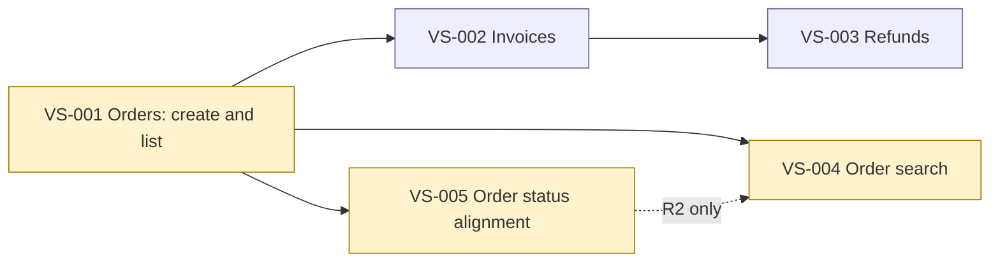

# Slice Index

The single status table for vertical slices. Example rows below use the invented "Acme Orders" domain; replace them with your own. Process: [`IMPLEMENTATION-GUIDE.md`](IMPLEMENTATION-GUIDE.md). Rules: [`CLAUDE.md`](CLAUDE.md).

## 1. Status

Status values: `Proposed`, `Analysed`, `Ready`, `In progress`, `Done`, `Blocked`. Priority score formula: see the guide, section 5 (higher is picked first).

| Id | Slice | Depends on (hard) | Value | Urgency | Unblocks | Effort | Priority | Readiness | Status | Rung | PR |
|----|-------|-------------------|:-----:|:-------:|:--------:|:------:|:--------:|-----------|--------|------|----|
| VS-001 | Orders: create and list (example) | none | 5 | 5 | 3 | 3 | 7.67 | Ready | In progress | R1 | #1 (example) |
| VS-002 | Invoices: generate from order (example) | VS-001 | 4 | 3 | 2 | 3 | 5.33 | Analysed, TQ-001 open | Analysed | - | - |
| VS-003 | Refunds: partial refund (example) | VS-002 | 3 | 2 | 1 | 5 | 2.20 | Analysed, BQ-001 open | Analysed | - | - |
| VS-004 | Order search and filters (example) | VS-001; R2 also VS-005 | 3 | 2 | 0 | 2 | 5.00 | Ready for R1; R2 built stacked on VS-005, which is not `Done` yet (BQ-005, BQ-006, TQ-004, TQ-005, TQ-006, TQ-007, BQ-008, TQ-008, TQ-009 open, non-blocking) | In progress | - | - |
| VS-005 | Orders: align statuses to BC-001 lifecycle (example) | VS-001 | 3 | 3 | 1 | 2 | 6.50 | Ready ([analysis](VS-005-order-status-alignment.md); OD-007, OD-008; BQ-009 open, non-blocking) | In progress | - | - |

Columns: Value, Urgency, Unblocks and Effort are 1-5 scores (Unblocks may be 0); Priority is computed, not guessed; Rung is the last rung merged (see the guide, section 2). In the example, VS-001 has merged R1 (PR `#1`, an invented number); real rows link a real PR.

## 2. Dependency graph

Edges point from a prerequisite to the slice that depends on it.

## 3. Open blockers

| Slice | Record | Decider | Summary |
|-------|--------|---------|---------|
| VS-002 | TQ-001 (example) | tech lead | How are gap-free invoice numbers allocated under concurrent issuing? BC-002 requires no gaps but does not say how |
| VS-003 | BQ-001 (example) | product owner | Does the 30-day refund window of BC-003 apply to digital goods? The KB is silent |
| VS-005 | BQ-009 (example) | product owner | Non-blocking: BC-001 has no state for a cancelled order, so the migration aborts on a cancelled row (BQ-009 stays open by the owner's decision, OD-007) |
| VS-004 | TQ-011 (example) | tech lead | Non-blocking: input rules of the R2 status filter (lowercase, case-sensitive, trimmed, blank means no filter); working assumption is the built behaviour |
| VS-004 | BQ-005, BQ-006, TQ-004, TQ-005, TQ-006 (example) | product owner / tech lead | Non-blocking: sort order, result visibility, currency for a deferred amount filter, typed-binding problem details for `page`/`pageSize` (TQ-005), container locale for case folding (TQ-006); working assumptions in the readiness analysis. BQ-006 is P1: answer it before R1 reaches any environment where non-staff identities can get a token |
| VS-004 | TQ-007, BQ-008, TQ-008, TQ-009 (example) | tech lead / product owner | Non-blocking, from the R1 review: rate limit and query timeout for search, customer name as personal data in URLs, error-key casing, NUL in create. TQ-007 and BQ-008 stay open and are not accepted (an acceptance is an OD with `accepted_risk` and `expires`, recorded only once the owner accepts) |

## 4. Revision log

| Date | Change | By |
|------|--------|----|
| 2026-01-01 | Template created with example rows | template |
| 2026-11-19 | VS-004 readiness analysis written ([`VS-004-order-search-and-filters.md`](VS-004-order-search-and-filters.md)); status Proposed -> Analysed; blockers BQ-003, BQ-004, TQ-003 recorded | requirements-analyst (trial) |
| 2026-11-19 | Owner answered BQ-003, BQ-004, TQ-003 (OD-002, OD-003, OD-004). VS-004 Analysed -> Ready for R1 (date range, customer name); R2 (status filter) depends on new slice VS-005 (status alignment, Proposed). VS-004 hard dependency on VS-001 still applies | requirements-analyst (trial) |
| 2026-11-19 | VS-004: BQ-007 answered (OD-005, UTC days); OD-006 grants a pickup exception so R1 may be built while VS-001 is still `In progress`. VS-004 status stays `Ready`: the guide moves it to `In progress` with the first R1 code PR | requirements-analyst (trial) |
| 2026-11-19 | VS-004 status Ready -> In progress: R1 (date-range and customer-name filters) implemented on branch `feat/pipeline-trial-slice`, pickup by OD-006; Rung stays `-` until R1 merges, PR link added once the PR exists | code-engineer (trial) |
| 2026-11-19 | VS-004: Mermaid class corrected (VS-004 moved to `inprogress`, it was still `proposed` after the status change); R1 review findings recorded as TQ-007, BQ-008, TQ-008, TQ-009 and a BQ-006 priority raise | requirements-analyst (trial) |
| 2026-11-20 | VS-005 readiness analysis written ([`VS-005-order-status-alignment.md`](VS-005-order-status-alignment.md)); TQ-010 and BQ-009 recorded (non-blocking); status Proposed -> In progress with the implementation on branch `feat/vs005-vs004-r2`; Rung and PR stay `-` until the PR exists and merges. The dependency on VS-001 (`In progress`) is open for the owner to confirm | code-engineer, requirements-analyst |
| 2026-11-20 | VS-004 R2 (status filter on the BC-001 states) implemented on the same branch, stacked on VS-005; VS-004 stays `In progress`; Rung stays `-` until R1 merges | code-engineer |
| 2026-11-20 | Owner decisions recorded: OD-007 answers TQ-010 (single-step migration, migrate first then start the API, lossy Down accepted, draft default); OD-008 waives the VS-001 dependency rule for VS-005 and VS-004 R2 only (cites OD-006). TQ-010 and the waiver rows removed from the blockers table; BQ-009 stays open and non-blocking. VS-004 R2 stays stacked on VS-005 and merges after it | code-engineer |
| 2026-11-20 | TQ-011 recorded (open, non-blocking, tech lead): input rules of the VS-004 R2 status filter, cited by criterion 9; added to the blockers table | code-engineer |
