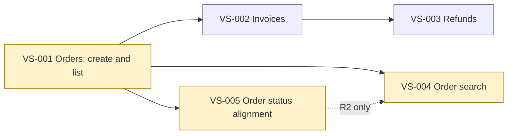

# Slice Index

The single status table for vertical slices. Example rows below use the invented "Acme Orders" domain; replace them with your own. Process: [`IMPLEMENTATION-GUIDE.md`](IMPLEMENTATION-GUIDE.md). Rules: [`CLAUDE.md`](CLAUDE.md).

## 1. Status

Status values: `Proposed`, `Analysed`, `Ready`, `In progress`, `Done`, `Blocked`. Priority score formula: see the guide, section 5 (higher is picked first).

| Id | Slice | Depends on (hard) | Value | Urgency | Unblocks | Effort | Priority | Readiness | Status | Rung | PR |
|----|-------|-------------------|:-----:|:-------:|:--------:|:------:|:--------:|-----------|--------|------|----|
| VS-001 | Orders: create and list (example) | none | 5 | 5 | 3 | 3 | 7.67 | Ready | In progress | R1 | n/a (example) |
| VS-002 | Invoices: generate from order (example) | VS-001 | 4 | 3 | 2 | 3 | 5.33 | Analysed (TQ-001 answered, OD-014) | Analysed | - | - |
| VS-003 | Refunds: partial refund (example) | VS-002 | 3 | 2 | 1 | 5 | 2.20 | Analysed (BQ-001 answered, OD-009) | Analysed | - | - |
| VS-004 | Order search and filters (example) | VS-001; R2 also VS-005 | 3 | 2 | 0 | 2 | 5.00 | Ready for R1 (VS-001 waiver OD-006); R2: VS-001 waiver OD-008, stacked on VS-005, not merged before it (OD-004) (no open question: BQ-005, BQ-006, TQ-004 to TQ-009, BQ-008 and TQ-011 answered in OD-010 to OD-012 and OD-015 to OD-021; their follow-up code is done in the slice follow-up PR) | In progress | - | - |
| VS-005 | Orders: align statuses to BC-001 lifecycle (example) | VS-001 | 3 | 3 | 1 | 2 | 6.50 | Ready ([analysis](VS-005-order-status-alignment.md); OD-007; VS-001 waiver OD-008; BQ-009 answered, OD-013) | In progress | - | - |

Columns: Value, Urgency, Unblocks and Effort are 1-5 scores (Unblocks may be 0); Priority is computed, not guessed; Rung is the last rung merged (see the guide, section 2). In the example, VS-001 has merged R1 (PR shown as `n/a (example)`, never a number that could match a real PR); real rows link a real PR. Mermaid classes follow the Status column (`framework_lint` checks it): `Proposed`, `Analysed` and `Ready` use `proposed`, `In progress` uses `inprogress`, `Done` uses `done`, `Blocked` uses `blocked`.

## 2. Dependency graph

Edges point from a prerequisite to the slice that depends on it.

## 3. Open blockers

| Slice | Record | Decider | Summary |
|-------|--------|---------|---------|
| none | none | - | No open question blocks or qualifies a slice. The questions raised by the trial are all answered |

Decided, with the code follow-up done (2026-11-20, slice follow-up PR): OD-011 (named authorization policy for the orders endpoints), OD-016 (explicit parsing of `page` and `pageSize`, `BadHttpRequestException` mapped to 400), OD-018 (rate limiter and command timeout), OD-019 (camelCase error keys on POST), OD-020 (reject NUL in create). Raised by that PR's review and answered the same day: TQ-013 (rate-limit partition claim, OD-026), TQ-014 (where log redaction is enforced, OD-027), TQ-015 (query cost bounds, OD-025; code done: page cap, timeout default 10 s, 503 on a timeout with Retry-After, per-user concurrency limit, OD-029). Open, non-blocking: TQ-016 (pool size and a load test at the largest page and table). OD-013 adds the `cancelled` state to the code vocabulary only when a cancellation feature is built; the VS-005 migration keeps stopping on a cancelled row until then. OD-012 (with OD-027) and OD-017 are redaction and database-locale requirements for the deployment configuration, not yet implemented.

## 4. Revision log

| Date | Change | By |
|------|--------|----|
| 2026-01-01 | Template created with example rows | template |
| 2026-11-19 | VS-004 readiness analysis written ([`VS-004-order-search-and-filters.md`](VS-004-order-search-and-filters.md)); status Proposed -> Analysed; blockers BQ-003, BQ-004, TQ-003 recorded | requirements-analyst (trial) |
| 2026-11-19 | Owner answered BQ-003, BQ-004, TQ-003 (OD-002, OD-003, OD-004). VS-004 Analysed -> Ready for R1 (date range, customer name); R2 (status filter) depends on new slice VS-005 (status alignment, Proposed). VS-004 hard dependency on VS-001 still applies | requirements-analyst (trial) |
| 2026-11-19 | VS-004: BQ-007 answered (OD-005, UTC days); OD-006 grants a pickup exception so R1 may be built while VS-001 is still `In progress`. VS-004 status stays `Ready`: the guide moves it to `In progress` with the first R1 code PR | requirements-analyst (trial) |
| 2026-11-19 | VS-004 status Ready -> In progress: R1 (date-range and customer-name filters) implemented on branch `feat/pipeline-trial-slice`, pickup by OD-006; Rung stays `-` until R1 merges, PR link added once the PR exists | code-engineer (trial) |
| 2026-11-19 | VS-004: Mermaid class corrected (VS-004 moved to `inprogress`, it was still `proposed` after the status change); R1 review findings recorded as TQ-007, BQ-008, TQ-008, TQ-009 and a BQ-006 priority raise | requirements-analyst (trial) |
| 2026-11-20 | VS-005 readiness analysis written ([`VS-005-order-status-alignment.md`](VS-005-order-status-alignment.md)); TQ-010 and BQ-009 recorded (non-blocking); status Proposed -> In progress with the implementation on branch `feat/vs005-vs004-r2`; Rung and PR stay `-` until the PR exists and merges. The dependency on VS-001 (`In progress`) is open for the owner to confirm | code-engineer, requirements-analyst |
| 2026-11-20 | VS-004 R2 (status filter on the BC-001 states) implemented on the same branch, stacked on VS-005; VS-004 stays `In progress`; Rung stays `-` until R1 merges | code-engineer |
| 2026-11-20 | Owner decisions recorded: OD-007 answers TQ-010 (single-step migration, migrate first then start the API, lossy Down accepted, draft default); OD-008 waives the VS-001 dependency rule for VS-005 and VS-004 R2 only (cites OD-006). TQ-010 and the waiver rows removed from the blockers table; BQ-009 stays open and non-blocking. VS-004 R2 stays stacked on VS-005 and merges after it | code-engineer |
| 2026-11-20 | TQ-011 recorded (open, non-blocking, tech lead): input rules of the VS-004 R2 status filter, cited by criterion 9; added to the blockers table | code-engineer |
| 2026-11-20 | Slice follow-up code done for OD-011, OD-016, OD-018, OD-019, OD-020; TQ-013 to TQ-015 raised (open, non-blocking) | code-engineer |
| 2026-11-20 | TQ-013, TQ-014, TQ-015 answered as OD-026, OD-027, OD-025 (code for OD-025 done); E10 answered as OD-028; confirmations recorded in OD-012, OD-018, OD-023; OD-029 (concurrency limit, Retry-After) and TQ-016 (open, non-blocking) added | code-engineer, documentation-curator |
| 2026-11-20 | Owner decisions recorded: BQ-001, BQ-005, BQ-006, BQ-008, BQ-009, TQ-001, TQ-004, TQ-005, TQ-006, TQ-007, TQ-008, TQ-009 and TQ-011 answered as OD-009 to OD-021; the process rules of the trial confirmed (OD-022); accepted risk for two allow-listed scripts (TQ-012, OD-023); no API version segment (OD-024). All rows removed from the Open blockers table; Readiness cells updated; BC-001 now lists a sixth state, `cancelled` | documentation-curator |
